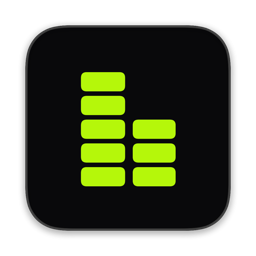
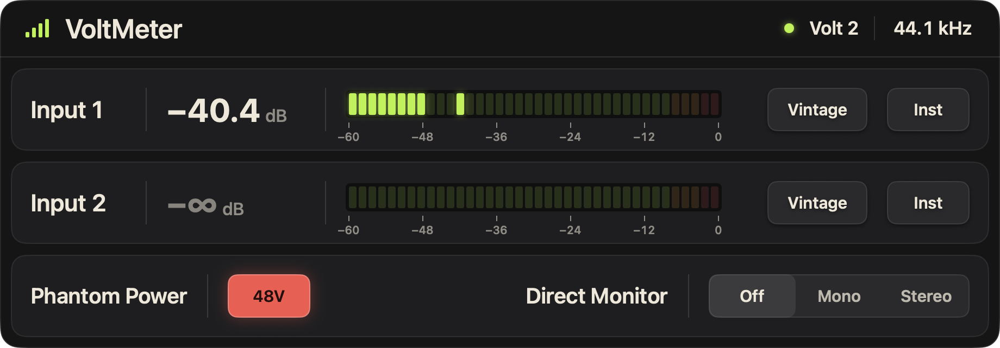

<p align="center">
  
</p>

<h1 align="center">VoltMeter</h1>

<p align="center">
  A floating input meter and remote control for the <b>Universal Audio Volt 2</b>, right on your Mac desktop.
</p>

<p align="center">
  
</p>

## Why

The Volt 2 is a lovely little interface, but its front panel is tiny and its only meters are a few LEDs. If the interface sits under your desk or behind a monitor, you are guessing your levels and squinting to see whether 48V is on.

VoltMeter puts the whole front panel on your screen:

- **Live input meters** for both channels, with peak hold, clip lamps and a dB readout.
- **Vintage, Inst, 48V and Direct Monitor** shown live, exactly as the hardware lights are.
- **Click to control.** Toggle Vintage, Inst and 48V, or switch Direct Monitor between Off, Mono and Stereo, from the app. The hardware follows instantly.
- **Sample rate picker.** Click the kHz label to switch between 44.1, 48, 88.2, 96 kHz and so on.
- **Floating panel** that stays above your DAW, at 100%, 150% or 200% (right-click the panel).

No UA driver, no UA Connect, no kernel extension. It talks to the Volt over plain USB.

## How it works

The Volt 2 is class compliant for audio, but it also exposes a small vendor HID interface that the UA software uses for the front panel. I sniffed it and it turns out to be one byte:

| Bit    | Meaning            |
|--------|--------------------|
| `0x80` | Vintage 2          |
| `0x40` | Vintage 1          |
| `0x20` | Inst 2             |
| `0x10` | Inst 1             |
| `0x08` | Direct, stereo     |
| `0x04` | Direct, mono       |
| `0x02` | 48V phantom power  |

- The device reports its state on **input report 1** (byte 1 is the bitmask above) whenever a button changes.
- Writing **output report `0x10`** as `[0x10, bits, 0, 0, 0]` sets the whole panel at once, and the device echoes the new state back.
- The gain and monitor knobs are analog, so they are not visible over USB.

Metering uses a Core Audio HAL IOProc on the Volt's input stream, and the device is found by name, so the meters work with any Volt model.

## Install

Download `VoltMeter.zip` from [Releases](../../releases), unzip it and drag **VoltMeter** to Applications.

The app is not notarized, so the first launch is blocked. Open **System Settings > Privacy & Security**, scroll down and click **Open Anyway**. Then allow microphone access, which is how macOS labels audio input.

## Build from source

Needs macOS 13+ (tested on 15) and the Xcode command line tools. No Xcode project, just one Swift file.

```bash
git clone https://github.com/orhager/VoltMeter.git
cd VoltMeter
zsh build.sh install
```

`build.sh` compiles with `swiftc`, builds the `.app` bundle and copies it to `/Applications`. If you have an Apple Development certificate it signs with it, so macOS remembers the microphone permission between builds; otherwise it signs ad hoc.

To change the icon, edit `icon.swift` and run:

```bash
swift icon.swift && iconutil -c icns AppIcon.iconset -o AppIcon.icns
```

## Good to know

- **Press any button on the Volt once after launch.** The device does not answer "what is your state?" requests, so the app learns the state from the first button change. Until then the controls are locked, so the app never overwrites settings it has not seen.
- **Button control is mapped for the Volt 2 only.** Volt 1, 176, 276 and 476 should get working meters, but their panels may use different bits. PRs with captures from other models are very welcome.
- Close it from the red x that appears when you hover over the logo, or from the menu bar icon.

## Disclaimer

Not affiliated with or endorsed by Universal Audio. Volt is a trademark of Universal Audio, Inc. The protocol was figured out by watching USB traffic; use at your own risk.

## License

MIT
